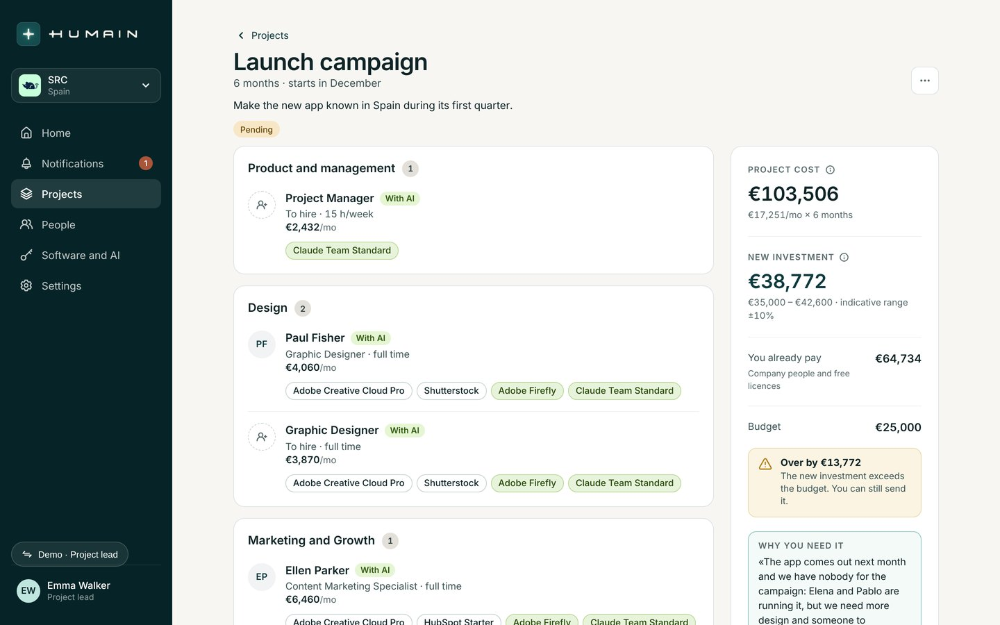

# HUMAIN

A functional prototype for planning a project's team, software and AI, and costing it before anyone is hired. Team leads get a costed proposal in two steps; Leadership approves it before any money is committed.

Live demo: **[humain-demo.pages.dev](https://humain-demo.pages.dev)** · English by default, Spanish with `?lang=es`

This README covers how the prototype is built. The product story, research and design decisions are in the case study on my portfolio. It is a prototype, not a production product: see [Limitations](#limitations).



## Stack

- Vanilla HTML, CSS and JavaScript (ES2020+). No framework and no build-time dependencies.
- One runtime dependency: [html2pdf.js](https://github.com/eKoopmans/html2pdf.js) 0.10.1, loaded from the cdnjs CDN only when a proposal is downloaded as a PDF. PDF export needs a network connection; the rest of the app works offline, with a system font in place of Geist.
- Delivered as one static `index.html`, built from `src/` by a Python script (standard library only).
- End-to-end tests with Playwright for Python.
- [Geist](https://vercel.com/font) font, loaded from Google Fonts.

## Project structure

```
index.html            Built app (deployed as-is)
brand/                Logo, isotype and banner image
src/
  index.html          HTML shell with build markers
  css/                Styles in 11 files: tokens and base, components, pages, adjustments
  js/                 Application code in 30 files, loaded in name order (below)
  i18n/en.js          English dictionary: 1,420 strings and 445 patterns
  icons.svg           SVG sprite, 69 icons
scripts/build.py      Concatenates and inlines src/ into index.html
tests/                Playwright end-to-end tests
docs/                 README images
```

The JavaScript files share one global scope and are concatenated in order, so the numbers in their names matter:

| Files | Responsibility |
| --- | --- |
| `00`–`04` | Setup, role taxonomy, project and people states, people on roles, licence seats |
| `05`–`08` | Cost model, changes to running projects, spending schedule, with-AI comparison |
| `09`–`11` | First run, demo seed data, loading and repairing saved data |
| `12`–`18` | Pages: Home, Projects, People, Software and AI, Settings, proposal and its export |
| `19`–`23` | App shell, rendering, forms and decisions, click actions, UI behaviours |
| `24`–`29` | Proposal conversation, mobile patterns, tool requests, moving people, translation layer |

## Run, build and test

```bash
# Run: no install needed (opening index.html directly also works)
python3 -m http.server 8000          # then open http://localhost:8000

# Build after editing src/ (syntax-checks the JS first if Node.js is installed)
python3 scripts/build.py

# Test
pip install playwright && python3 -m playwright install chromium
python3 tests/model.py    # cost and hours model, seat inventory, data repair
python3 tests/smoke.py    # every page and the full project flow, both roles, desktop and mobile
python3 tests/ui.py       # focus management, HTML injection, review flow, no dead controls
python3 tests/states.py   # contact sheets of interaction states, written to tests/output/
```

Set `CHROME_PATH` to use an installed Chrome instead of Playwright's Chromium.

## Architecture

- **State.** One state object holds the domain data (projects, roles, people, licences, notifications) and is saved to `localStorage` after each change. View state (current page, open menu or modal, toasts) lives in a separate object and is never saved.
- **Rendering.** `render()` rebuilds the page regions (sidebar, header, main, footer, modal, toasts) from state using template strings. User-entered text goes through an escaping function before it reaches the DOM.
- **Events.** Interactions are handled by a small set of document-level listeners that dispatch on `data-` attributes, so re-rendered markup needs no rebinding.
- **Data loading.** Saved data is validated and repaired on load: numbers are clamped to valid ranges, missing lists are rebuilt, and anything unrecoverable falls back to the demo data. Data under the previous storage key is migrated.
- **Internationalisation.** The interface is written in Spanish. In English, a `MutationObserver` translates text nodes and selected attributes from a dictionary of exact strings plus patterns with placeholders, and reformats numbers and currency. Demo data is translated too, but text typed by users is never touched.

## Domain logic

**Cost model**
- One function, `cost()`, prices a project. It is pure: it never changes the project it prices, and the same input gives the same result.
- Role rates start from Spanish market salary studies (gross annual, mid level), plus employer on-costs, converted to a monthly rate. Every rate keeps its source.
- One constant, 150 hours per person-month, serves both price and capacity. It comes from the annual working time in Spain's IT and consulting collective agreement (BOE, 2025).
- AI productivity is set per area from controlled studies, with a value and a range; where no study exists, the value is labelled as an estimate. The with-AI and without-AI comparison prices two variants of the same team with the same `cost()` and the same deadline.
- One schedule function decides when a project spends money. The project total and the spending forecast both use it, so they cannot disagree.

**Availability**
- A person is busy when a seat on an approved, running project points to them. For a new project, only work still running when it starts counts, so someone who finishes earlier shows as free.
- People already placed in a proposal that hasn't started yet show as "Proposed", so nobody is promised to two projects.

**Licences**
- A licence has contracted seats and holders. A project only adds seats for people on it who don't hold one yet, and uses them from its first to its last month.
- Projects are served in order of start date, so per-project seat counts add up to the licence totals.

**Approval workflow**
- Projects move through draft, pending, changes requested, approved, in progress, finished, rejected and cancelled.
- Changing a running project creates a full copy of its team, which is edited and reviewed while the approved version keeps running.
- Leadership's comments and the lead's replies stay attached to the project as one conversation.

## Testing

The suites drive the real interface in a browser, with the interface in Spanish (`?lang=es`), the source language.

| Suite | What it checks | Fails on |
| --- | --- | --- |
| `model.py` | Cost and hours model: the team covers the estimated work for every project type, size and deadline; a longer deadline doesn't change the work or raise the monthly cost; half a person costs half; the forecast adds up to the project total. Purity: pricing and rendering never change the data or depend on call order. Seats: per-project seat needs match the licence inventory and the Software and AI page. Rates: role, company and market rates in the right order of precedence. With-AI comparison: AI never costs more than its licences, zero gain saves nothing. Data: corrupt saved data is repaired, old data is migrated, user text is escaped. Rules: Leadership doesn't see drafts, approval starts a project, archived projects leave the totals | Any failed check or page error |
| `smoke.py` | First run (empty company and demo), persistence after reload, every page in both roles, an active and a draft proposal, export, and the full flow (new project → proposal → send → approve → in progress), at desktop and mobile sizes | Any failed check, JavaScript error, console error (except font and network loading) or browser dialog |
| `ui.py` | Page titles, notifications marked read, focus management in dialogs, HTML injection through the UI, the live region for messages, the person form, seat origin changing the investment, the review flow (a rejection needs a reason, ask for changes, resend, withdraw available, approve, mark a hire as joined), resetting the demo, no enabled control without an effect | Any failed check or page error |
| `states.py` | Not a pass/fail test: contact sheets of rest, hover, focus, active and disabled states per component, plus page screenshots, for visual review in `tests/output/` | — |

The pass/fail suites are run after every change as a regression check before it is accepted.

## Technical decisions and trade-offs

| Decision | Why | Cost |
| --- | --- | --- |
| No framework, single-file output | Nothing to install or build beyond Python, deploys anywhere as one static file | Source files share one global scope instead of modules |
| PDF export through html2pdf.js from a CDN | Real A4 PDFs without adding a build step | Loaded from a third-party CDN without an integrity hash; export fails offline |
| `localStorage` instead of a backend | Every visitor gets their own working copy of the demo | No accounts, permissions or shared data |
| Re-render from state | Simple and predictable at this size | Does not scale to large data sets |
| Translation layer over the DOM | English added without rewriting the Spanish source | Every new string needs a dictionary entry |

## How it was built

I designed HUMAIN and directed its implementation with Claude (Anthropic) as an AI development tool. I defined the requirements, business rules and acceptance criteria for each change, and reviewed every result in the browser before accepting it. Claude wrote the code, the tests and the translation layer, and ran the test suites.

## Limitations

- **No backend.** Data lives in the browser's `localStorage`, per device. The role switch is a demo control, not authentication.
- **Demo data.** The company, people and projects are fictional. Market rates are indicative references from public sources.
- **Translation layer.** An untranslated string appears in Spanish.
- **Code organisation.** Built through iterative prototyping. The code is split into files by responsibility, but they share one global scope; rendering and click handling are each a single large function (about 640 and 2,100 lines), and some styles override earlier ones. Suitable for the current prototype scope; growing it would need ES modules and a component structure.
- **Testing scope.** Chromium only, at desktop and mobile sizes. Automated accessibility checks (axe-core) report no violations on the main screens, but it has not been tested with assistive-technology users or in other browsers.

## License

All rights reserved. See [LICENSE](LICENSE).
